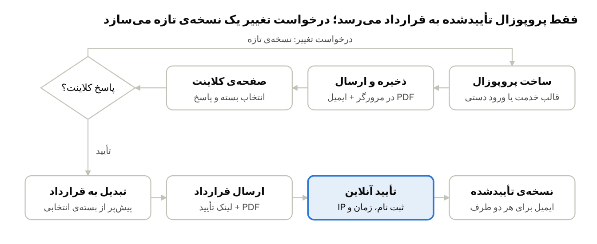
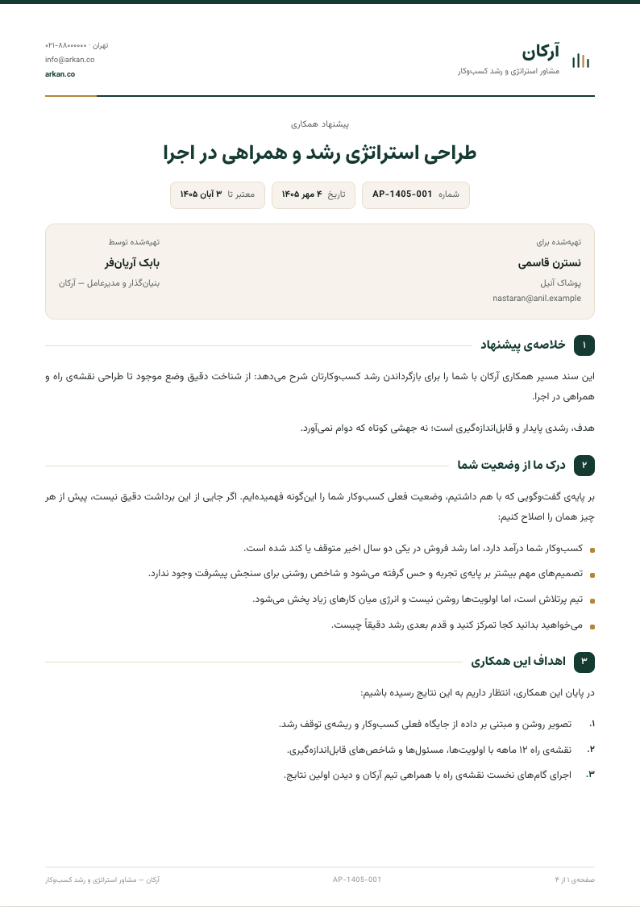
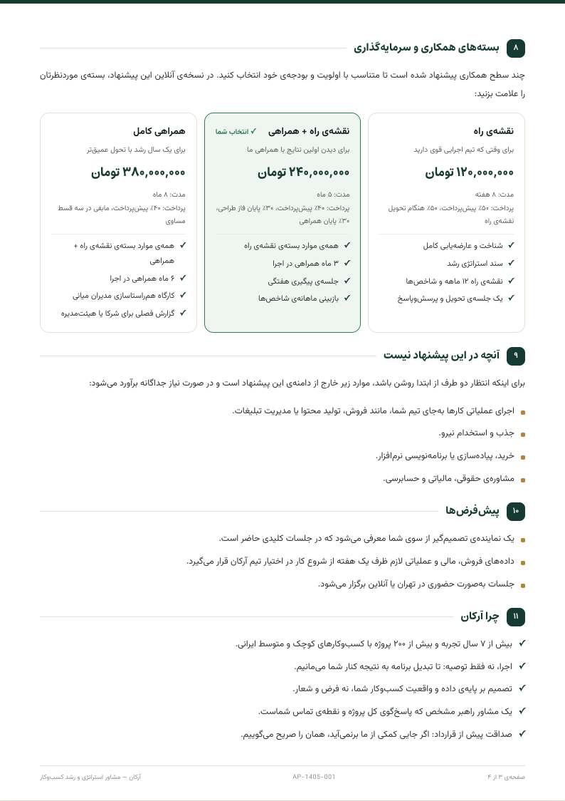
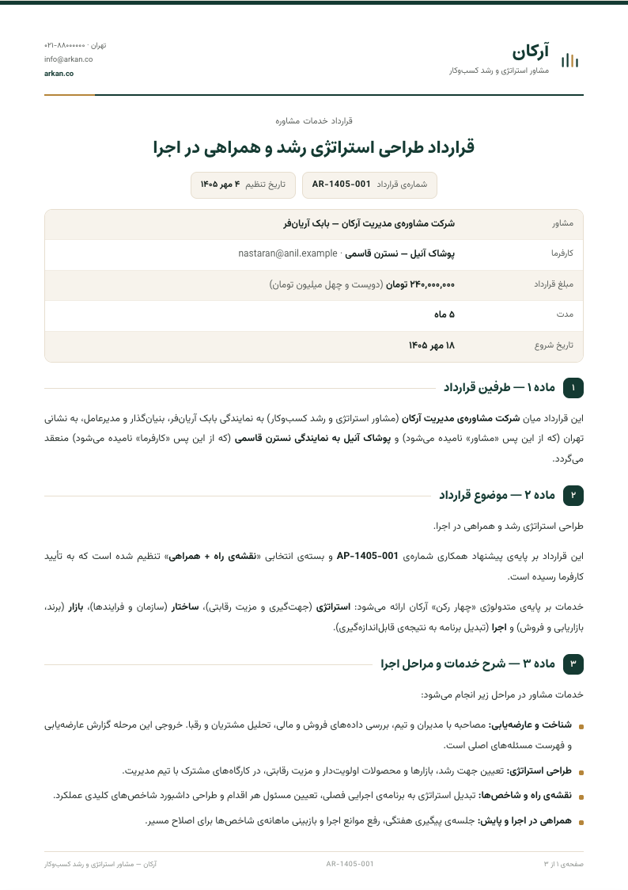
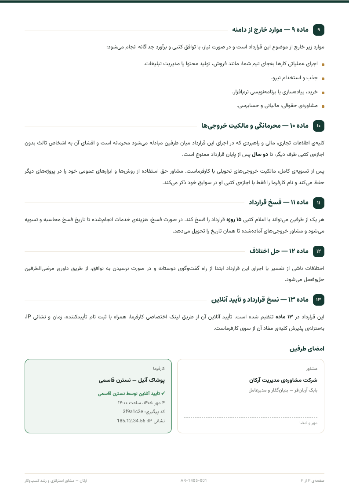

# از پروپوزال تا قرارداد در آرکان

به CRM آرکان بخش «پروپوزال ← قرارداد» اضافه شد. پیشنهاد همکاری از قالب خدمات آرکان ساخته می‌شود، PDF آن در مرورگر تولید و با ایمیل ارسال می‌شود، کلاینت آنلاین بسته را انتخاب و تأیید می‌کند، و پروپوزال با یک کلیک به قرارداد تبدیل می‌شود. این درس مسیر کار، کد و درس‌های فنی آن را توضیح می‌دهد.

> درس فاز ۴ دوره‌ی هوش مصنوعی · مهر ۱۴۰۵ · برگرفته از سیستم پروپوزال و قرارداد پروژه‌ی Career Guide

---

## جریان کار



درخواست تغییر کلاینت همان پروپوزال را با شماره‌ی نسخه‌ی بعدی دوباره ارسال می‌کند؛ رد کردن پروپوزال را می‌بندد. فقط تأیید به قرارداد می‌رسد. اگر پروپوزال به یک معامله وصل باشد، ارسال آن معامله را خودکار به مرحله‌ی «ارسال پروپوزال» در کانبان می‌برد.

## خروجی واقعی: صفحه‌های PDF

این صفحه‌ها همان چیزی است که کلاینت به‌صورت PDF پیوست ایمیل می‌گیرد (داده‌ی نمایشی).

| پروپوزال: جلد و خلاصه | پروپوزال: بسته‌های همکاری |
|---|---|
|  |  |

| قرارداد: صفحه‌ی اول | قرارداد: امضای طرفین پس از تأیید آنلاین |
|---|---|
|  |  |

---

## نقشه‌ی کد

این ۱۲ فایل را به ترتیب جریان کار بخوانید.

| فایل | نقش |
|---|---|
| [templates.ts](../src/lib/crm/proposals/templates.ts) | ۵ قالب پروپوزال با متن مخصوص خدمات آرکان و بسته‌های قیمتی به تومان |
| [blocks.ts](../src/lib/crm/proposals/blocks.ts) | ترتیب بخش‌های سند پروپوزال به‌صورت فهرست بلوک‌ها، بدون React |
| [sheet-kit.tsx](../src/components/documents/sheet-kit.tsx) | کاغذ A4، بلوک‌های پایه و صفحه‌بند «اول اندازه بگیر، بعد بچین» |
| [pdf.ts](../src/lib/documents/pdf.ts) | تبدیل صفحه‌ها به PDF در مرورگر و نگه داشتن حجم زیر ۲٫۹ مگابایت |
| [ProposalComposer.tsx](../src/components/admin/crm/ProposalComposer.tsx) | فرم پروپوزال، پیش‌نمایش زنده و جریان «ذخیره، چیدن دوباره، PDF، ارسال» |
| [proposal-actions.ts](../src/app/admin/proposal-actions.ts) | سرور‌اکشن‌های پنل: ذخیره، ارسال، پاسخ به کلاینت، لغو و تبدیل به قرارداد |
| [proposal/actions.ts](../src/app/proposal/actions.ts) | پاسخ کلاینت از لینک عمومی، بدون لاگین |
| [contract-template.ts](../src/lib/crm/contract-template.ts) | متن ۱۳ ماده‌ای قرارداد آرکان و پیش‌پر شدنش از پروپوزال |
| [contract-blocks.ts](../src/lib/crm/contract-blocks.ts) | خواننده‌ی کوچک Markdown که متن قرارداد را به بلوک‌های A4 تبدیل می‌کند |
| [contract/actions.ts](../src/app/contract/actions.ts) | تأیید آنلاین قرارداد و ارسال نسخه‌ی تأییدشده برای هر دو طرف |
| [email.ts](../src/lib/crm/email.ts) | قالب ایمیل‌های برند آرکان و ارسال با Resend |
| [proposals-schema.sql](../supabase/proposals-schema.sql) | جدول‌های پروپوزال و گفت‌وگو + سه ستون تازه‌ی قرارداد |

---

## پنج درس فنی

این پنج تصمیم، ساخت سند و ارسال آن را قابل اعتماد کرد. هر کدام را در کد پیدا کنید.

1. **PDF در مرورگر، نه روی سرور.** مرورگر متن فارسی را با فونت واقعی و ترتیب درست راست‌به‌چپ می‌چیند؛ از هر صفحه‌ی A4 تصویر گرفته و PDF ساخته می‌شود. پس PDF دقیقاً همان چیزی است که روی صفحه می‌بینید. هزینه‌اش: متن PDF تصویر است و قابل جست‌وجو نیست.
2. **اول اندازه بگیر، بعد بچین.** هر بخش سند یک «بلوک» است. همه‌ی بلوک‌ها یک بار بیرون از دید رندر و اندازه‌گیری می‌شوند، بعد در صفحه‌ها چیده می‌شوند. تیتر به بلوک بعدی می‌چسبد و فهرست بلند بین دو صفحه شکسته می‌شود.
3. **ارکستریتور باز هم کد است.** ارسال پنج گام پشت‌سرهم دارد: ذخیره و گرفتن شماره‌ی واقعی، چیدن دوباره‌ی سند با همان شماره، صبر برای `onReady`، ساخت PDF و صدا زدن سرور‌اکشن. همان درس فاز ۳: جریان کار را کد کنترل می‌کند، نه مدل.
4. **لینک توکن‌دار به‌جای لاگین کلاینت.** کلاینت حساب کاربری ندارد؛ یک uuid غیرقابل‌حدس در لینک، کلید دسترسی اوست. تأیید قرارداد دو مرحله دارد: اول نام، زمان سرور و IP ثبت می‌شود، بعد PDF با همان زمان ساخته و ایمیل می‌شود.
5. **محدودیت‌های محیط را بشناسید.** Vercel بدنه‌ی بالای ۴٫۵ مگابایت را رد می‌کند و سرور‌اکشن‌های Next به‌طور پیش‌فرض ۱ مگابایت می‌پذیرند؛ برای همین PDF زیر ۲٫۹ مگابایت فشرده و `bodySizeLimit` روی `4mb` گذاشته شده. جدول تازه در اسکیمای سفارشی `arkan` بدون `grant` حتی برای کلید سرور بسته است. متن لاتین وسط فارسی (ایمیل، IP، شماره‌تلفن) باید جهت خودش را داشته باشد، وگرنه جابه‌جا نمایش داده می‌شود.

---

## راه‌اندازی روی پروژه‌ی خودتان

ترتیب مهم است: اول دیتابیس، بعد دیپلوی. کد تازه روی دیتابیس قدیمی، هنگام تأیید قرارداد خطا می‌دهد.

1. کد را از همین ریپو بگیرید و `npm install` بزنید. دو کتابخانه‌ی تازه اضافه شده: `jspdf` و `html2canvas-pro`. راهنمای کامل قدم‌به‌قدم در [README](../README.md) است.
2. روی پروژه‌ی تازه‌ی Supabase، اول `supabase/00-arkan-schema.sql` و بعد بقیه‌ی فایل‌های SQL را به ترتیب README اجرا کنید. بعد در Data API ← Exposed schemas، اسکیمای `arkan` را اضافه کنید. اگر CRM قبلی را دارید، فقط `supabase/proposals-schema.sql` را اجرا کنید.
3. در [Resend](https://resend.com) یک دامنه یا زیردامنه تأیید کنید. بدون دامنه‌ی تأییدشده، Resend فقط به ایمیل صاحب حساب می‌فرستد.
4. سه متغیر جدول زیر را هم در `.env.local` و هم در تنظیمات Vercel بگذارید. اگر مقدار را از `vercel env pull` برمی‌دارید، مراقب «\n» نوشتاری آخر آن باشید.
5. بعد از افزودن متغیرها در Vercel، دوباره دیپلوی کنید. متغیر تازه فقط روی دیپلوی بعدی اثر دارد.
6. جریان کامل را با ایمیل خودتان آزمایش کنید: پروپوزال بسازید، ارسال کنید، از لینک تأیید کنید، به قرارداد تبدیل و ارسال کنید و قرارداد را تأیید کنید.

| متغیر | نمونه | کاربرد |
|---|---|---|
| `RESEND_API_KEY` | `re_…` | کلید ارسال ایمیل |
| `RESEND_FROM` | `Arkan <arkan@send.example.com>` | فرستنده، روی دامنه‌ی تأییدشده |
| `CRM_NOTIFY_EMAIL` | `you@example.com` | اعلان پاسخ کلاینت و نسخه‌ی تأییدشده (اختیاری) |

---

## تمرین‌ها

هر تمرین روی همین کد ساخته می‌شود و یکی از الگوهای فازهای قبل را تمرین می‌دهد.

- [ ] **پیش‌نویس پروپوزال با AI:** بخش «درک ما از وضعیت شما» را از روی خلاصه‌ی گفتگوی چت‌بات مخاطب پر کنید؛ با الگوی `generateText` + zod + یک retry در `src/lib/crm/ai.ts`.
- [ ] **یادآوری خودکار:** پروپوزالی که سه روز «دیده‌شده» مانده و پاسخی نگرفته، با یک کران روزانه ایمیل پیگیری بگیرد.
- [ ] **برد خودکار معامله:** وقتی کلاینت قرارداد را تأیید کرد، معامله‌ی مرتبط به «بسته‌شده (موفق)» برود و در تایم‌لاین مخاطب فعالیت ثبت شود.
- [ ] **بایگانی PDF:** نسخه‌ی ارسالی و نسخه‌ی تأییدشده را در یک باکت خصوصی Supabase Storage ذخیره و در پنل لینک دانلود امن بگذارید.
- [ ] **PDF با متن قابل جست‌وجو:** همین سند را روی سرور با Playwright و `page.pdf()` بسازید و حجم و کیفیت را با نسخه‌ی مرورگری مقایسه کنید.
- [ ] **گزارش نرخ تبدیل:** در صفحه‌ی گزارش‌ها نشان دهید چند درصد پروپوزال‌های ارسالی تأیید و به قرارداد تبدیل شده‌اند.

---

## پرامپت پیشنهادی برای Claude Code

این پرامپت همین بخش را روی CRM خودتان می‌سازد. نام شرکت، خدمات و اسکیمای دیتابیس را با پروژه‌ی خودتان عوض کنید. نسخه‌ی کامل و دقیق‌تر در [پرامپت مرجع CRM](../پرامپت%20استفاده%20شده/arkan-crm-claude-code-prompt.md)، «بخش چهارم» است.

```
تو روی CRM من کار می‌کنی (Next.js 14 App Router + TypeScript + Tailwind + Supabase، همه‌چیز فارسی و RTL).
یک بخش «پروپوزال ← قرارداد» اضافه کن:

۱. جدول proposals (مشخصات کلاینت، متن بخش‌ها به‌صورت jsonb، بسته‌های قیمتی، وضعیت، view_token، revision)
   و جدول proposal_comments. RLS فعال بدون policy و grant صریح برای service_role.
۲. صفحه‌ی /admin/crm/proposals: فرم با یک قالب آماده برای هر خدمت شرکت، ورود دستی یا انتخاب از
   مخاطبان CRM، و پیش‌نمایش زنده‌ی A4 کنار فرم.
۳. PDF را در مرورگر بساز (jsPDF + html2canvas-pro). هر بخش یک بلوک است؛ بلوک‌ها را اول
   بیرون از دید اندازه بگیر، بعد در صفحه‌های A4 بچین. تیتر به بلوک بعدی بچسبد و
   فهرست بلند بین صفحه‌ها بشکند. حجم PDF زیر ۲٫۹ مگابایت بماند.
۴. «ارسال با ایمیل»: اول ذخیره کن تا شماره‌ی واقعی بگیری، سند را با همان شماره دوباره
   بچین، بعد PDF بساز و با سرور‌اکشن و Resend پیوست کن. لینک /proposal/[token] در ایمیل باشد.
۵. صفحه‌ی عمومی /proposal/[token] بدون لاگین: کلاینت بسته را انتخاب و تأیید می‌کند،
   درخواست تغییر می‌دهد یا رد می‌کند. بازدید و پاسخ ثبت شود و به هر دو طرف ایمیل برود.
۶. «تبدیل به قرارداد»: بسته‌ی انتخابی مبلغ، مدت و شرایط پرداخت شود، مراحل شرح خدمات
   و موارد خارج از دامنه یک ماده‌ی قرارداد. اگر مخاطب در CRM نیست، بساز.
۷. قرارداد: پیش‌نمایش A4، ارسال با ایمیل، تأیید آنلاین کلاینت با ثبت نام،
   زمان سرور و IP، و ایمیل نسخه‌ی تأییدشده برای هر دو طرف.

الگوهای پروژه را رعایت کن: هر سرور‌اکشن guard ← zod ← عملیات ← audit ← revalidate،
کد خوانا و آموزشی. بعد از تغییرات npm run build بزن.
```
